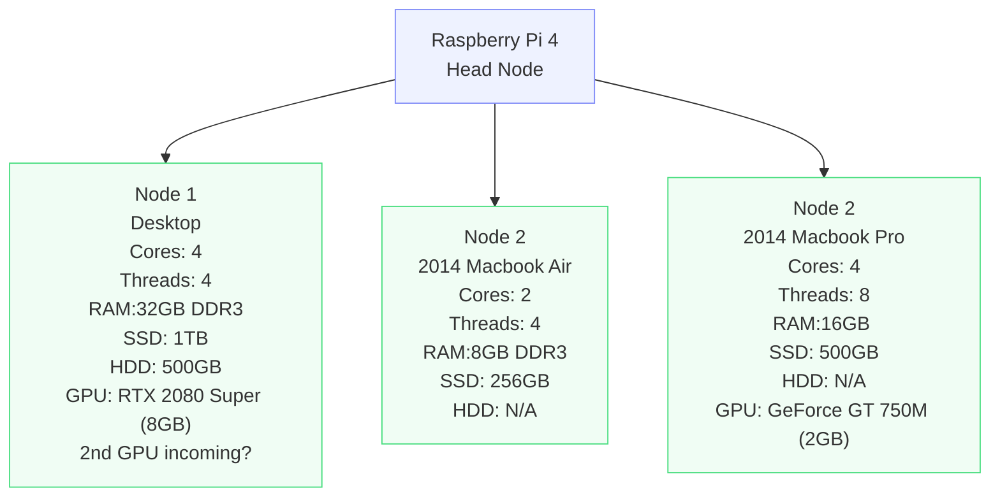

# Low Performance Compute Cluster

This contains setup and maintenance details for my "low performance compute cluster". Consider it more of a lab notebook for now...

I got the idea to build a homelab bioinformatics (or other) server by cobbling together a couple of computers that on their own would be unimpressive. 

## Thanks
This has been a great learning experience, thanks to:
- Casey Martin 
    - CPU + MoBo + finding good deals on parts 
    - Answering question after question, and pointing me in the right direction since grad school
- Jonah DeVaney
    - Helping me learn to code on the Node 2 macbook air back in college
    - Pointing me in the right direction since undergrad
- Ryan Redman
    - Giving me the idea for a low performance compute cluster in the first place
    - Making tasty chili
